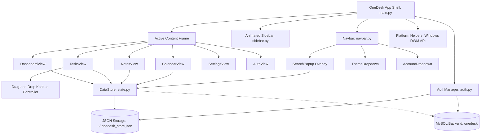
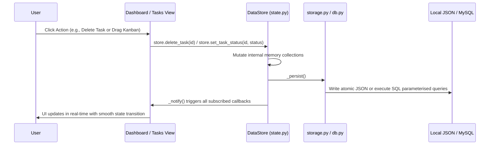
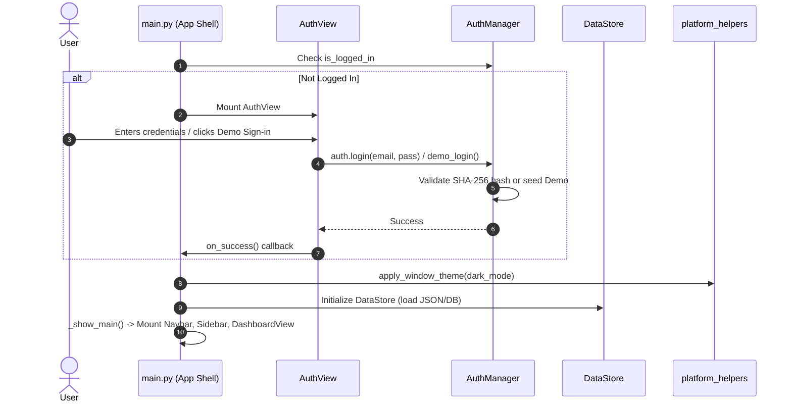
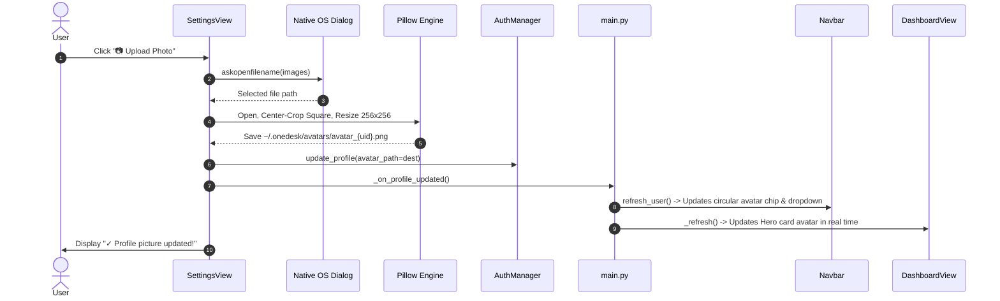
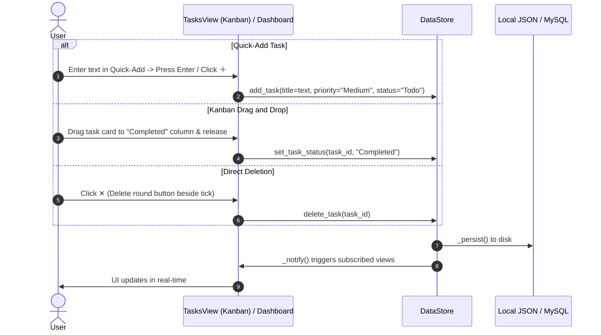
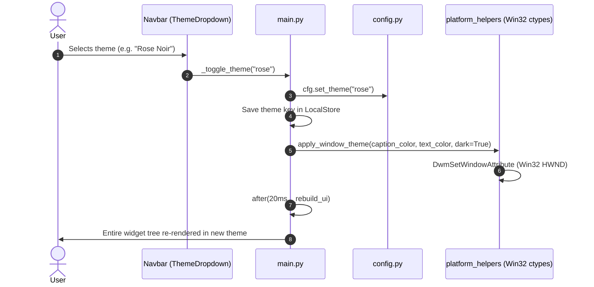

# OneDesk — Comprehensive Project Architecture & Technical Guide

This document provides a complete, in-depth explanation of the **OneDesk** desktop productivity application. It covers everything from high-level architecture and design philosophies to subsystem mechanics, data pipelines, widget hierarchies, platform integration, and developer guides.

---

## Table of Contents

1. [Executive Summary & Purpose](#1-executive-summary--purpose)
2. [High-Level Architecture](#2-high-level-architecture)
   - [Architectural Paradigm](#architectural-paradigm)
   - [System Context & Component Diagram](#system-context--component-diagram)
   - [Data Flow & Reactive State Pipeline](#data-flow--reactive-state-pipeline)
   - [Hybrid Persistence Pipeline](#hybrid-persistence-pipeline)
3. [Project Directory & File Structure](#3-project-directory--file-structure)
4. [Core Subsystems & Engine Architecture](#4-core-subsystems--engine-architecture)
   - [4.1 Application Orchestrator (`main.py`)](#41-application-orchestrator-mainpy)
   - [4.2 Design System & Theming Engine (`onedesk/config.py`)](#42-design-system--theming-engine-onedeskconfigpy)
   - [4.3 Reactive Data Store & State Engine (`onedesk/state.py`)](#43-reactive-data-store--state-engine-onedeskstatepy)
   - [4.4 Hybrid Storage Layer (`onedesk/storage.py`)](#44-hybrid-storage-layer-onedeskstoragepy)
   - [4.5 Relational Database Layer (`onedesk/db.py` & `setup_db.sql`)](#45-relational-database-layer-onedeskdbpy--setup_dbsql)
   - [4.6 Authentication & Profile Engine (`onedesk/auth.py`)](#46-authentication--profile-engine-onedeskauthpy)
   - [4.7 Windows DWM & Platform Enhancements (`onedesk/platform_helpers.py`)](#47-windows-dwm--platform-enhancements-onedeskplatform_helperspy)
5. [UI Component Architecture](#5-ui-component-architecture)
   - [5.1 Reusable UI Helpers & Canvas Widgets (`ui_helpers.py`)](#51-reusable-ui-helpers--canvas-widgets-ui_helperspy)
   - [5.2 Animated Collapsible Sidebar (`sidebar.py`)](#52-animated-collapsible-sidebar-sidebarpy)
   - [5.3 Top Navbar & Floating Dropdowns (`navbar.py`)](#53-top-navbar--floating-dropdowns-navbarpy)
   - [5.4 Live Categorized Search Popup (`search_popup.py`)](#54-live-categorized-search-popup-search_popuppy)
   - [5.5 Modal Dialogs & Alerts (`modals.py`)](#55-modal-dialogs--alerts-modalspy)
6. [Application Views Deep Dive](#6-application-views-deep-dive)
   - [6.1 Auth View (`auth_view.py`)](#61-auth-view-auth_viewpy)
   - [6.2 Dashboard View (`dashboard_view.py`)](#62-dashboard-view-dashboard_viewpy)
   - [6.3 Tasks View & Drag-and-Drop Kanban (`tasks_view.py`)](#63-tasks-view--drag-and-drop-kanban-tasks_viewpy)
   - [6.4 Notes View (`notes_view.py`)](#64-notes-view-notes_viewpy)
   - [6.5 Calendar View (`calendar_view.py`)](#65-calendar-view-calendar_viewpy)
   - [6.6 Settings View (`settings_view.py`)](#66-settings-view-settings_viewpy)
   - [6.7 Analytics View (`analytics_view.py`)](#67-analytics-view-analytics_viewpy)
7. [End-to-End Execution Lifecycles](#7-end-to-end-execution-lifecycles)
   - [User Authentication & Session Bootstrapping](#user-authentication--session-bootstrapping)
   - [Dynamic Profile Picture Processing & Live Propagation](#dynamic-profile-picture-processing--live-propagation)
   - [Task Creation, Kanban Drag-and-Drop, & Direct Deletion](#task-creation-kanban-drag-and-drop--direct-deletion)
   - [Theme Switching & Native DWM Re-rendering](#theme-switching--native-dwm-re-rendering)
8. [Setup, Configuration & Operating Modes](#8-setup-configuration--operating-modes)
   - [Offline Mode (Zero Configuration)](#offline-mode-zero-configuration)
   - [MySQL Database Backend Configuration](#mysql-database-backend-configuration)
9. [Developer Extension Guide](#9-developer-extension-guide)

---

## 1. Executive Summary & Purpose

**OneDesk** is a personal productivity and workspace management desktop application built with **Python 3.13** and **Tkinter**, elevated by modern UI design patterns, **Pillow** image manipulation, and **Windows Desktop Window Manager (DWM)** integration.

### Core Problems OneDesk Solves:
1. **Tool Fragmentation**: Consolidates daily planning, task execution (Kanban & List), quick note capture, and calendar scheduling into a single unified desktop client.
2. **Heavy Desktop App Bloat**: Unlike Electron-based productivity apps that consume gigabytes of memory, OneDesk starts up instantaneously with a lean memory footprint (~40–80 MB RAM) by utilizing native Tkinter graphics.
3. **Data Sovereignty & Offline Independence**: Operates without mandatory cloud connectivity. It saves state locally in an encrypted/sanitized JSON datastore while seamlessly upgrading to a local or remote **MySQL 8.x** server with connection pooling if configured.
4. **Desktop Aesthetic Excellence**: Implements modern design principles:
   - 4 bespoke high-contrast themes (Midnight Purple, Rose Noir, Aqua Emerald, Lavender Light).
   - Anti-aliased canvas round action buttons and pill badges.
   - Smooth animated transitions for collapsible sidebars.
   - Native Windows 10/11 title bar dark mode synchronization.
   - Circular user profile picture avatars with smart center-cropping and real-time live synchronization.

---

## 2. High-Level Architecture

### Architectural Paradigm

OneDesk follows a decoupled **Model-View-Component (MVC)** pattern combined with a **Reactive Pub/Sub State Model**:

```
                       ┌──────────────────────────────────────────────┐
                       │                   main.py                    │
                       │           (App Shell & Lifecycle)            │
                       └──────┬────────────────────────────────┬──────┘
                              │                                │
                     Controls │                                │ Instantiates
                              ▼                                ▼
                 ┌─────────────────────────┐      ┌─────────────────────────┐
                 │       Views Layer       │      │    Components Layer     │
                 │  - DashboardView        │      │  - Navbar & Dropdowns   │
                 │  - TasksView (Kanban)   │◄────►│  - Animated Sidebar     │
                 │  - NotesView            │      │  - Search Popup Overlay │
                 │  - CalendarView         │      │  - Modal Dialogs        │
                 │  - SettingsView         │      │  - RoundIconButton      │
                 │  - AuthView             │      │  - Circular Avatars     │
                 └────────────┬────────────┘      └─────────────────────────┘
                              │
                    Subscribe │ Notify State
                              ▼
                 ┌─────────────────────────────────────────────────────────┐
                 │                  onedesk/state.py                       │
                 │              (Reactive DataStore Hub)                   │
                 └────────────┬───────────────────────────────┬────────────┘
                              │                               │
                              ▼                               ▼
                 ┌─────────────────────────┐     ┌─────────────────────────┐
                 │    onedesk/storage.py   │     │      onedesk/db.py      │
                 │  (JSON File Persistence)│     │  (MySQL Connection Pool)│
                 └─────────────────────────┘     └─────────────────────────┘
```

### System Context & Component Diagram



### Data Flow & Reactive State Pipeline

The application state is strictly centralized in `DataStore` ([onedesk/state.py](file:///r:/onedesk-tkinter/onedesk/state.py)):
1. **Mutations**: Whenever a task is marked complete, deleted, created, or moved on the Kanban board, or a note/event is modified, the view invokes a store method (e.g., `store.toggle_complete(id)`, `store.delete_task(id)`, `store.set_task_status(id, status)`).
2. **Persistence**: The store immediately updates its internal Python data structures and calls `_persist()`, flushing changes to `storage.py` and/or `db.py`.
3. **Notification**: The store iterates through all registered observer callbacks in `_listeners` and executes `_notify()`.
4. **Reactive Re-render**: Active views (`DashboardView`, `TasksView`, `CalendarView`, `NotesView`) subscribed via `store.subscribe(self._refresh)` instantly re-render their data without requiring manual parent-child state passing.

### Hybrid Persistence Pipeline



---

## 3. Project Directory & File Structure

```
onedesk-tkinter/
│
├── main.py                     # Entry point, Window initialization, View router, DWM themes
├── config.ini                  # MySQL database credentials and connection parameters
├── setup_db.sql                # Complete SQL schema initialization script
├── requirements.txt            # Python dependencies (mysql-connector-python, Pillow, matplotlib)
├── README.md                   # User-facing summary and highlights
├── PROJECT_EXPLANATION.md       # Comprehensive architectural and technical guide
│
└── onedesk/                    # Core application package
    ├── __init__.py             # Package marker
    ├── config.py               # Design tokens, themes (Dark, Light, Rose, Aqua), fonts
    ├── state.py                # Reactive DataStore with pub/sub listener architecture
    ├── storage.py              # Local JSON file persistence, mock data seeders, backup export
    ├── auth.py                 # User authentication, session management, profile & avatars
    ├── db.py                   # MySQL connection pooling, parameterised queries, health check
    ├── importers.py            # Multi-format parsers for importing Notes, Tasks, and Events
    ├── platform_helpers.py     # Windows DWM titlebar dark mode, DPI scaling, window centering
    │
    ├── components/             # Reusable UI widgets and dialogs
    │   ├── __init__.py         # Component exports
    │   ├── ui_helpers.py       # RoundIconButton, circular avatars, pills, badges, scroll frames
    │   ├── sidebar.py          # Animated collapsible navigation sidebar (210px <-> 58px)
    │   ├── navbar.py           # Top header bar, live search, theme dropdown, account dropdown
    │   ├── search_popup.py     # Live floating search results dropdown overlay
    │   ├── card.py             # Themed panel container
    │   └── modals.py           # Note, Task, Event dialog modals and confirmation prompts
    │
    └── views/                  # Primary screen controllers
        ├── __init__.py         # View registry
        ├── auth_view.py        # Login / Signup screen with mode switcher & theme picker
        ├── dashboard_view.py   # Modern overview: hero avatar, 6 metrics, 3-column workspace
        ├── tasks_view.py       # List & Kanban views with interactive card drag-and-drop
        ├── notes_view.py       # Grid of colored notes, search, pin/unpin, export to .txt
        ├── calendar_view.py    # Month, Week, Day calendar views with task deadline badges
        ├── settings_view.py    # Profile picture upload/remove, themes, JSON backup export
        └── analytics_view.py   # Embedded Matplotlib charts for productivity insights
```

---

## 4. Core Subsystems & Engine Architecture

### 4.1 Application Orchestrator (`main.py`)
`OneDeskApp` in [main.py](file:///r:/onedesk-tkinter/main.py) is the root application controller.

- **Initialization Sequence**:
  1. Calls `enable_high_dpi()` from `platform_helpers.py` before creating `tk.Tk()`.
  2. Loads persisted theme preference from storage; calls `cfg.set_theme(...)`.
  3. Configures root window title, dimensions (`1180x740`), minimum boundaries (`900x580`), and centers the window on the display.
  4. Applies Windows DWM native title bar styling (`apply_window_theme`).
  5. Initializes `AuthManager` and `DataStore`.
  6. Inspects `auth.is_logged_in`: if authenticated, mounts `_show_main()`; otherwise mounts `_show_auth()`.
- **View Router**:
  Maintains the active screen container (`_content_area`). When `_navigate(view_name)` is triggered, the existing view is destroyed and the new view is cleanly mounted.
- **Theme Lifecycle Engine**:
  When `_toggle_theme(theme_name)` is called:
  - Updates `cfg.set_theme(new_theme)` and saves to storage.
  - Re-applies Windows DWM title bar dark/light attribute via Win32 ctypes.
  - Executes a deferred rebuild (`after(20, self._rebuild_ui)`) to ensure all Tkinter widget references and click handlers terminate cleanly without throwing `TclError`.

### 4.2 Design System & Theming Engine (`onedesk/config.py`)
Centralized design token repository in [onedesk/config.py](file:///r:/onedesk-tkinter/onedesk/config.py):

- **4 Curated Palettes**:
  - `DARK` (*Midnight Purple*): Deep obsidian background (`#0f0c1b`), royal card surfaces (`#19142b`), and vibrant purple accents (`#a855f7`).
  - `LIGHT` (*Lavender Light*): Clean lilac-tinted white background (`#f5f3ff`), pure white cards (`#ffffff`), and violet text/accents (`#7c3aed`).
  - `ROSE` (*Rose Noir*): Burgundy velvet cards (`#1f0d17`) with rich crimson accents (`#f43f5e`).
  - `AQUA` (*Aqua Emerald*): Obsidian oceanic teal (`#051314`) with electric cyan highlights (`#06b6d4`).
- **Dynamic Color Accessor `cfg.C(key)`**:
  Widgets query colors through `cfg.C("bg")`, `cfg.C("accent")`, `cfg.C("text")`, ensuring dynamic theme resolution at any moment.
- **Font Matrix `cfg.FONT`**:
  Uses `Segoe UI` on Windows with fallbacks to `SF Pro Display`, `Inter`, and `system-ui`. Sizes range from `xs` (8pt), `sm` (9pt), `base` (10pt), `md` (11pt), `lg` (12pt), `xl` (14pt), `2xl` (18pt) up to `3xl` (22pt), with both normal and bold variants.

### 4.3 Reactive Data Store & State Engine (`onedesk/state.py`)
`DataStore` in [onedesk/state.py](file:///r:/onedesk-tkinter/onedesk/state.py) holds in-memory collections of:
- `notes`: `list[dict]` (id, title, description, category, tags, color, pinned, createdAt).
- `tasks`: `list[dict]` (id, title, description, priority, dueDate, status, category, completedAt).
- `events`: `list[dict]` (id, title, date, time, reminder, description).

**Computed Metrics & Aggregates**:
- `completed_tasks`: Returns all tasks where `status == "Completed"`.
- `pending_tasks`: Returns all tasks where `status != "Completed"`.
- `overdue_tasks`: Computes tasks whose `dueDate < today.isoformat()` and are not completed.
- `today_events`: Automatically filters and sorts events scheduled for today by timestamp.
- `completion_pct`: Computes percentage integer (`0% - 100%`) for visual progress gauges.

### 4.4 Hybrid Storage Layer (`onedesk/storage.py`)
Handles disk serialization into `~/.onedesk_store.json`:
- **Atomic File Writes**: Prevents file corruption during unexpected application terminations by serializing to JSON and writing atomically.
- **Mock Data Seeders**: When first launched, automatically seeds realistic tasks, notes, and calendar events for instant exploration.
- **Backup System**: `export_backup()` bundles notes, tasks, and events into a timestamped portable JSON structure; `import_backup()` validates and restores state.

### 4.5 Relational Database Layer (`onedesk/db.py` & `setup_db.sql`)
- **Connection Pooling**: Utilizes `mysql.connector.pooling.MySQLConnectionPool(pool_name="onedesk_pool", pool_size=5)` to reuse connections efficiently across queries.
- **Graceful Fallback**: `db.is_available()` performs a non-blocking test connection on boot. If MySQL is unavailable (e.g. offline laptop), OneDesk automatically falls back to JSON storage without crashing.
- **Security**: All SQL statements use parameterised format dictionaries (`%(param)s`), eliminating SQL injection vulnerabilities.

### 4.6 Authentication & Profile Engine (`onedesk/auth.py`)
- **Dual Authentication**: Attempts MySQL query first; falls back to `storage.py` users list.
- **Password Security**: Passwords are never stored in plain text; SHA-256 digests (`hashlib.sha256`) are computed and matched.
- **Demo User**: Instant one-click login for `alex@lifeos.workspace` with pre-configured mock data.
- **Profile & Avatar Management**:
  - Holds `avatar_path` pointing to user avatar images.
  - Updates profile metadata in session and propagates changes to active persistent storage.

### 4.7 Windows DWM & Platform Enhancements (`onedesk/platform_helpers.py`)
- **Per-Monitor High-DPI Awareness**: Calls `ctypes.windll.shcore.SetProcessDpiAwareness(1)` or `user32.SetProcessDPIAware()`, ensuring fonts and borders render sharp and crisp on 4K/retina displays.
- **DWM Native Title Bar Immersive Dark Mode**:
  Uses `ctypes.windll.dwmapi.DwmSetWindowAttribute`:
  - `DWMWA_USE_IMMERSIVE_DARK_MODE` (attribute ID `20`, fallback `19`): Switches the Windows OS window chrome to dark mode.
  - `DWMWA_CAPTION_COLOR` (attribute ID `35`): Colorizes the title bar to match `cfg.C("card")`.
  - `DWMWA_TEXT_COLOR` (attribute ID `36`): Synchronizes title text color.
  - `DWMWA_BORDER_COLOR` (attribute ID `34`): Styles the 1px window frame border.

### 4.8 Multi-Format Import Engine (`onedesk/importers.py`)
Provides format parsers and loaders to ingest external productivity data into OneDesk:
- **Notes Parsing (`parse_notes_file`)**:
  - Ingests **JSON** (`.json`), **CSV** (`.csv`), and **Markdown/Text** (`.txt`, `.md`).
  - Automatically extracts section headings (`# Heading`), tags, categories, and descriptions.
- **Tasks Parsing (`parse_tasks_file`)**:
  - Ingests **JSON** (`.json`), **CSV** (`.csv`), and **Markdown Checklists** (`.txt`, `.md`).
  - Supports standard todo syntax: `- [ ] Todo`, `- [x] Completed`, priority tags `(High)`, and category hashtags `#Work`.
- **Calendar Activities Parsing (`parse_events_file`)**:
  - Ingests universal **iCalendar (`.ics`)** files exported from Google Calendar, Outlook, and Apple Calendar (`BEGIN:VEVENT` blocks).
  - Also supports **JSON** (`.json`) arrays and **CSV** (`.csv`) with automatic timestamp and reminder extraction.

---

## 5. UI Component Architecture

### 5.1 Reusable UI Helpers & Canvas Widgets (`ui_helpers.py`)

#### `RoundIconButton(tk.Canvas)`
Because native Tkinter `tk.Button` elements cannot produce clean anti-aliased circular shapes with dynamic hover palettes across operating systems, `RoundIconButton` is implemented as an interactive `tk.Canvas`:
- Draws an anti-aliased oval via `create_oval()` and centers text/unicode icons via `create_text()`.
- Tracks `<Enter>` and `<Leave>` events to smoothly tint background and text colors.
- Dispatches click commands upon `<Button-1>` release.
- Binds built-in floating tooltip overlays.

#### `create_circular_avatar(image_path, size, text, bg, fg)`
- Utilizes the **Pillow** image library:
  1. Opens source image (PNG, JPG, JPEG, WEBP, BMP).
  2. Center-crops image to a strict square (`min(w, h)`).
  3. Resizes down to specified dimensions using high-fidelity `Image.Resampling.LANCZOS`.
  4. Generates an 8-bit alpha mask (`ImageDraw.ellipse`) to mask pixels into a circle.
  5. Returns a `ImageTk.PhotoImage` reference.
- **Fallback**: If no image is provided or the file is missing, generates a circular pill colored with `cfg.C("accent")` containing the user's capitalized initials.

#### `make_pill_badge` & `make_badge`
Creates styled labels with rounded visual margins, typography, and theme-aware colors for priorities (`High`, `Medium`, `Low`) and statuses (`Todo`, `In Progress`, `Completed`).

#### `ModernScrollbar` & `ScrollableFrame`
- **`ModernScrollbar`**: Custom canvas-based fluid scrollbar widget replacing vintage OS scrollbars. Implements rounded pill geometry, 6px-to-8px hover expansion, accent color shifting on hover/drag, interactive track jumping, smooth scrub dragging, and smart auto-hiding when content doesn't overflow.
- **`ScrollableFrame`**: Custom auto-scrolling container combining an outer `tk.Frame`, an embedded `tk.Canvas`, and the integrated `ModernScrollbar`. Automatically resizes internal window bindings (`<Configure>`), exposes `.canvas`, `.scrollbar`, `.scroll_to_top()`, and `.scroll_to_bottom()`, and handles cross-platform mouse wheel scrolling (`<MouseWheel>` on Windows/macOS, `<Button-4>`/`<Button-5>` on Linux).

### 5.2 Animated Collapsible Sidebar (`sidebar.py`)
- **Smooth Width Transition**:
  Switches between `EXPANDED_W = 210px` and `COLLAPSED_W = 58px`. An internal animation loop executes across 10 steps (`ANIM_STEPS = 10`) at 14ms intervals (`ANIM_MS = 14`), calculating intermediate widths via linear interpolation for a 60 FPS transition.
- **Active Navigation Indicators**:
  Features a vertical accent indicator bar on the left edge of the selected workspace item, highlighting the current view (**Dashboard**, **Notes**, **Tasks**, or **Calendar**).

### 5.3 Top Navbar & Floating Dropdowns (`navbar.py`)
The header bar coordinates global application utilities:
- **Global Search Input**: Real-time entry field hooked to keystroke events, automatically displaying the floating `SearchPopup`.
- **Quick-Add Button**: Opens the `TaskDialog` from anywhere in the application.
- **Theme Dropdown (`ThemeDropdown`)**:
  A borderless `tk.Toplevel` anchored below the theme button. Lists all 4 themes with color swatch indicators, checkmarks for active selection, and auto-dismiss on click-away or `<Escape>`.
- **Account Dropdown (`AccountDropdown`)**:
  Anchored below the user's circular avatar chip. Displays user name, email, and circular avatar preview, with direct routes to **Settings** and **Sign Out**.

### 5.4 Live Categorized Search Popup (`search_popup.py`)
- Floating overlay positioned dynamically below the navbar search input.
- Groups matches into **Tasks**, **Notes**, and **Events**.
- Shows matched snippets with clickable rows that open their respective editing dialogs directly.
- Handles `<FocusOut>` and boundary checks to prevent clipped displays near screen edges.

### 5.5 Modal Dialogs & Alerts (`modals.py`)
Contains structured dialogs:
- `TaskDialog`: Title, description, priority segmented picker, due date picker, category, and status.
- `NoteDialog`: Title, description, category selector, multi-tag entry, and color theme picker (violet, cyan, green, amber, rose).
- `EventDialog`: Event title, date, time, reminder checkbox, and description.
- `confirm()`: Accessible custom confirmation modal with danger action buttons.

---

## 6. Application Views Deep Dive

### 6.1 Auth View (`auth_view.py`)
The authentication screen handles user entry:
- **Segmented Control**: Symmetrical toggle switching between **Sign In** and **Create Account** modes.
- **Password Mask Toggle**: Inline button toggling password character masking (`•` vs. cleartext) and swapping `👁 Show` / `🔒 Hide` icons.
- **Top Theme Bar**: Users can switch color schemes before logging in.
- **Instant Demo Sign-In**: Single-click button instantly enters demo mode without requiring typing.
- **Form Validation**: Error labels with real-time feedback for duplicate emails or invalid credentials.

### 6.2 Dashboard View (`dashboard_view.py`)
The primary home screen is organized into 3 sections:
1. **Fluid Hero Greeting Banner**:
   - Displays a 52px circular user profile avatar with a hover ring. Clicking it routes to Settings.
   - Welcomes the user with a dynamic time-of-day greeting (e.g., *Morning Focus*, *Afternoon Momentum*, *Evening Wrap-up*).
   - Contains an inline **Quick-Add Task Bar** with a round `＋` action button.
2. **6-Metric Overview Strip**:
   - Round icon bubbles for **Tasks**, **Done**, **Pending**, **Notes**, and **Today's Events**.
   - The 6th card is an active **Completion Rate Gauge** featuring an animated fill meter bar showing current productivity percentage.
   - Clicking any metric card routes to that workspace section.
3. **3-Column Workspace**:
   - **Column 0 (Pending Tasks)**: Displays active tasks with priority badges, title, due date, and **dual round action buttons**:
     - `✓` (Complete): Toggles task to Completed state.
     - `✕` (Delete): Positioned beside the tick box, deletes the task from store immediately.
   - **Column 1 (Today's Schedule)**: Lists scheduled events for today with time pill badges and reminder icons.
   - **Column 2 (Recent Notes)**: Displays recent note cards with color tints, pinned markers, and category tags.

### 6.3 Tasks View & Drag-and-Drop Kanban (`tasks_view.py`)
Supports dual modes toggled via header pills:
- **List View**: Displays tasks in a row format with priority tags, status indicators, inline completion checkboxes, edit modal openers, and deletion controls.
- **Kanban Board View with Drag-and-Drop**:
  - 3 columns: **Todo**, **In Progress**, and **Completed**.
  - **Drag-and-Drop Mechanics**:
    1. Clicking and holding a task card (`<ButtonPress-1>`) initializes drag state.
    2. Moving the mouse (`<B1-Motion>`) spawns a floating, semi-transparent preview window (`_show_drag_preview`) with `alpha=0.88` tracking the mouse pointer.
    3. The hovered destination column detects pointer intersection (`winfo_rootx`, `winfo_rooty`) and lights up with an accent highlight border (`cfg.C("accent")`).
    4. Releasing the mouse (`<ButtonRelease-1>`) transfers the task to the destination status via `store.set_task_status(task_id, target_column)`.
- **Search & Filters**: Real-time filtering by text query and status filters (**All**, **Overdue**, **Todo**, **In Progress**, **Completed**).

### 6.4 Notes View (`notes_view.py`)
- **Card Grid**: Notes render as visual cards with customizable color accents (Violet, Cyan, Green, Amber, Rose).
- **Pinning**: Pinned notes automatically sort to the top of the grid with a 📌 badge.
- **Text Export**: Features an "Export" action allowing users to dump note contents to a `.txt` file via native save dialogs.
- **Filtering**: Instant category filter pills (**All**, **Work**, **Personal**, **College**).

### 6.5 Calendar View (`calendar_view.py`)
- **Multi-View Modes**: Switch between **Month Grid (42 cells)**, **Week Agenda (7 days)**, and **Day Timeline**.
- **Deadline Indicators**: Calendar cells show scheduled events and task deadline markers for tasks due on that day.
- **Event Management**: Create new events with timestamp flags and notification reminders.

### 6.6 Settings View (`settings_view.py`)
- **Profile Picture Management**:
  - Live 68px circular preview.
  - **📷 Upload Photo**: Opens a file picker, center-crops the image, resizes it to 256×256, stores it in `~/.onedesk/avatars/avatar_{uid}.png`, and updates user state.
  - **✕ Remove**: Appears when a custom avatar exists, reverting to default initials.
- **Display Name Editor**: Change name with live update across views.
- **Visual Appearance Grid**: 4 clickable interactive theme cards with live color swatches.
- **Data Management**:
  - Export state to JSON file.
  - Import and restore state from JSON backup.
  - Clear all data with safety confirmation prompt.
- **Account Sign Out**: Clears session and returns to login view.

### 6.7 Analytics View (`analytics_view.py`)
- Integrates **Matplotlib** with Tkinter via `FigureCanvasTkAgg`.
- Renders visual bar charts and donut plots for task completion ratios, priority spreads, and note category distributions matching the active color theme.

---

## 7. End-to-End Execution Lifecycles

### User Authentication & Session Bootstrapping



### Dynamic Profile Picture Processing & Live Propagation



### Task Creation, Kanban Drag-and-Drop, & Direct Deletion



### Theme Switching & Native DWM Re-rendering



---

## 8. Setup, Configuration & Operating Modes

### Offline Mode (Zero Configuration)
OneDesk runs offline out of the box. No database installation or external services are required:
```bash
# Clone the repository
git clone https://github.com/RajRishabh15/OneDesk-Tkinter.git
cd OneDesk-Tkinter

# Install Python requirements
pip install -r requirements.txt

# Run OneDesk
python main.py
```
*Data will be saved automatically to `~/.onedesk_store.json`.*

### MySQL Database Backend Configuration
To connect OneDesk to a relational database backend:

1. **Initialize the Database**:
   ```bash
   mysql -u root -p < setup_db.sql
   ```
2. **Configure Connection Parameters**:
   Edit [config.ini](file:///r:/onedesk-tkinter/config.ini) in the project root:
   ```ini
   [mysql]
   host = localhost
   port = 3306
   user = root
   password = your_password_here
   database = onedesk
   ```
3. **Launch OneDesk**:
   ```bash
   python main.py
   ```
   *OneDesk will automatically detect MySQL via `onedesk/db.py` and synchronize users, tasks, notes, and events.*

---

## 9. Developer Extension Guide

### How to Add a New Theme
1. Open [onedesk/config.py](file:///r:/onedesk-tkinter/onedesk/config.py).
2. Define a new color dictionary (e.g., `EMERALD = { "bg": "#...", "card": "#...", ... }`).
3. Add the theme key and metadata tuple into `THEME_META`:
   ```python
   THEME_META = [
       # ...
       ("emerald", "Emerald Forest", "🌲", "#059669", "#064e3b"),
   ]
   ```
4. Register the theme in `THEMES` mapping:
   ```python
   THEMES["emerald"] = EMERALD
   ```

### How to Add a New Workspace View
1. Create your view class in `onedesk/views/my_view.py`:
   ```python
   import tkinter as tk
   from .. import config as cfg

   class MyCustomView(tk.Frame):
       def __init__(self, parent, store, **kw):
           kw.setdefault("bg", cfg.C("bg"))
           super().__init__(parent, **kw)
           self._store = store
           self._store.subscribe(self._refresh)
           self._build()

       def destroy(self):
           self._store.unsubscribe(self._refresh)
           super().destroy()

       def _build(self):
           tk.Label(self, text="My Custom View", font=cfg.FONT["2xl_b"],
                    bg=cfg.C("bg"), fg=cfg.C("text")).pack(padx=20, pady=20)

       def _refresh(self):
           pass
   ```
2. Export your view in `onedesk/views/__init__.py`.
3. Register the view in `VIEW_MAP` in [main.py](file:///r:/onedesk-tkinter/main.py):
   ```python
   VIEW_MAP = {
       "Dashboard": DashboardView,
       "Notes":     NotesView,
       "Tasks":     TasksView,
       "Calendar":  CalendarView,
       "Settings":  SettingsView,
       "Custom":    MyCustomView,
   }
   ```
4. Add the navigation item to `NAV_ITEMS` in [onedesk/components/sidebar.py](file:///r:/onedesk-tkinter/onedesk/components/sidebar.py):
   ```python
   NAV_ITEMS = [
       ("Dashboard", "⊞"),
       ("Notes",     "📝"),
       ("Tasks",     "✔"),
       ("Calendar",  "📅"),
       ("Custom",   "⚡"),
   ]
   ```

### How to Add Custom Data Fields to Tasks or Notes
1. Update `add_task` or `add_note` in [onedesk/state.py](file:///r:/onedesk-tkinter/onedesk/state.py) to accept the new keyword arguments.
2. In [onedesk/components/modals.py](file:///r:/onedesk-tkinter/onedesk/components/modals.py), add entry fields to `TaskDialog` or `NoteDialog`.
3. If using MySQL, update the schema in [setup_db.sql](file:///r:/onedesk-tkinter/setup_db.sql) and alter table via SQL:
   ```sql
   ALTER TABLE tasks ADD COLUMN estimated_hours INT DEFAULT 0;
   ```
4. Update query parameters in [onedesk/storage.py](file:///r:/onedesk-tkinter/onedesk/storage.py) or `state.py` where SQL queries are executed.
